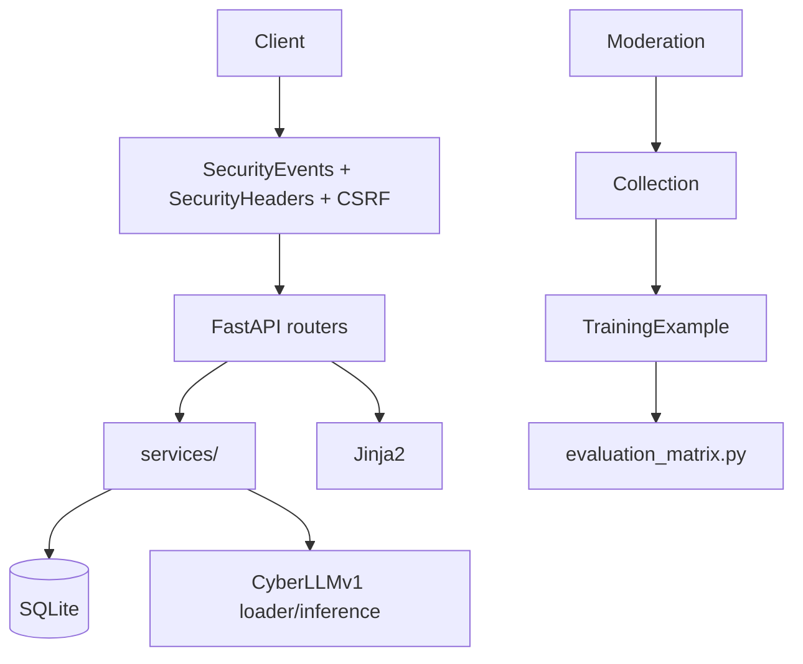

# SentientAI

Local cybersecurity-oriented web application with CyberLLMv1 model integration, deterministic security rules, and a human-reviewed moderation pipeline. A public blogging and community site backed by a private administration panel, plus a native desktop Security Lab.

Current version: `1.0.0-rc.2` (release candidate — see `VERSION`, `CHANGELOG.md`). The obsolete Sentinel model pipeline was removed on 2026-10-27 and replaced by CyberLLMv1 (see §2, §12). Deterministic rules and model-based analysis are separate components; human review remains the gate.

Verified on Linux (this branch, 2026-10-28): website suite 635 passed + 1 skipped, Security Lab suite 86 passed + 1 skipped. NOT yet verified: Windows test run, Windows exe build/double-click, GPU fit/latency, real 1.7B inference on the reference PC. Linux results are not proof of Windows compatibility.

## Contents

- [1. Project Overview](#1-project-overview)
- [2. Current Project Status](#2-current-project-status)
- [3. Features](#3-features)
- [4. Architecture](#4-architecture)
- [5. Technology Stack](#5-technology-stack)
- [6. Project Directory Structure](#6-project-directory-structure)
- [7. System Requirements](#7-system-requirements)
- [8. Installation](#8-installation)
- [9. Desktop Security Lab .exe (Windows)](#9-desktop-security-lab-exe-windows)
- [10. Environment Configuration](#10-environment-configuration)
- [11. Running SentientAI](#11-running-sentientai)
- [12. CyberLLMv1 Model Details](#12-cyberllmv1-model-details-sentinel-models-removed-2026-10-27)
- [13. Security Detection and Moderation](#13-security-detection-and-moderation)
- [14. Training and Data Governance](#14-training-and-data-governance)
- [15. Testing](#15-testing)
- [16. Evaluation and Diagnostics](#16-evaluation-and-diagnostics)
- [17. Database and Administration](#17-database-and-administration)
- [18. Troubleshooting](#18-troubleshooting)
- [19. Security and Responsible Use](#19-security-and-responsible-use)
- [20. Limitations and Roadmap](#20-limitations-and-roadmap)
- [21. Contributing and Development](#21-contributing-and-development)
- [22. License](#22-license)
- [23. Project Disclaimer](#23-project-disclaimer)
- [24. Documentation Links](#24-documentation-links)

### Key docs

- [INSTALL.md](INSTALL.md) — complete beginner installation guide (code, dependencies, model download, config, admin, module map, verify checklist)
- [CYBERLLM_WINDOWS_SETUP.md](CYBERLLM_WINDOWS_SETUP.md) — Windows setup (Python, CUDA, model download, verification)
- [CYBERLLM_PORTABLE_SETUP.md](CYBERLLM_PORTABLE_SETUP.md) — portable install and model setup
- [cyberLLMv1/MODEL_CARD.md](cyberLLMv1/MODEL_CARD.md) — CyberLLM Pilot v8 model card (base, adapter SHA, eval, limits)
- [security_lab/README.md](security_lab/README.md) — desktop Security Lab user guide
- [security_lab/ARCHITECTURE.md](security_lab/ARCHITECTURE.md) — Security Lab architecture
- [security_lab/packaging/BUILD_GUIDE.md](security_lab/packaging/BUILD_GUIDE.md) — Windows exe build guide (compile, first run, feature checklist)
- [CHANGELOG.md](CHANGELOG.md) — version history and release notes
- [WINDOWS_TEST_CHECKLIST.md](WINDOWS_TEST_CHECKLIST.md) — Windows verification checklist

## 1. Project Overview

**What it is:** FastAPI + Jinja2 + SQLAlchemy community publishing platform with authentication, posts/comments/likes/bookmarks/follows/messages/notifications/search, plus an internal "Sentinel" assistant and the ATTACT assessment toolkit.

**What problem it aims to solve:** Give a realistic, self-hosted content site where security controls, content moderation, and model-assisted triage can be exercised end-to-end without external dependencies.

**Who it is for:** Developers and reviewers who want a runnable local app with real auth, moderation, and evaluation harnesses.

**What currently works:** Public site, auth, admin moderation queue, deterministic brute-force/port-scan rules, CyberLLMv1 classification + rules fusion, ATTACT checks, rate limiting, CSRF, audit log, training review queue, native desktop Security Lab GUI (Control Center, authorized scanner, model testing, user management, reports, cases, demo, diagnostics, settings), admin users API with backend-enforced guards, portable Windows runtime (`run.bat`/`run.sh`; uses `.venv`/`venv` if present, else the system Python). (The obsolete Sentinel Model A/B pipeline was removed on 2026-10-27; see §12.)

**What remains experimental:** Per-category detection beyond rules, automated training. CyberLLMv1 classification is validated JSON with evidence checks, but it is not a deployable detector on its own — human review is still required for consequential decisions.

## 2. Current Project Status

Honest summary (see `reports/migration_obsolete_models_removed.md` for the 2026-10-27 migration):

- Classification: CyberLLMv1 (Qwen3-1.7B + LoRA v8, data-v3.2) via `app/services/classifier.py`, fused with deterministic rules (50% rules / 50% confident model; rules-only when the model is unavailable, unparseable, or evidence-inconsistent). No dual-model inference, no model agreement, no Sentinel checkpoints.
- Deterministic rules: brute-force (8 variants) and port-scan working. Evaluation 26-case: rules precision 0.90 recall 0.56 F1 0.69 (historical, rules unchanged by the migration).
- Moderation: human-only. The old Sentinel moderation model was removed; CyberLLMv1 is not a content-moderation model.
- Human review required for all consequential decisions.
- Branch and version: `feature/cyberllm-desktop-portable`, version `1.0.0-rc.2` (`VERSION`, `CHANGELOG.md`, tag `v1.0.0-rc.2`). Stable `v1.0.0` requires the Windows battery: exe build + double-click, GPU fit/latency, real 1.7B inference, Windows test run.
- Desktop app: native PySide6 Security Lab (`security_lab/`, 9 pages); the exe bundles the GUI only — backend deps, torch, and model files stay on the machine (see `security_lab/packaging/BUILD_GUIDE.md`).
- Rollback: check out tag `v1.0.0-rc.2` (previous candidate: `v1.0.0-rc.1`; procedure in `CHANGELOG.md`).

Do NOT treat any single model output as a reliable detector; do NOT claim automatic blocking.

## 3. Features

| Feature | Status | Component |
|---|---|---|
| Registration, login, JWT session, password change/reset | Implemented | `app/api/auth.py`, `services/auth_service.py` |
| Posts (draft/published/archived), comments, likes, bookmarks, follows | Implemented | `app/api/blog.py`, `social.py` |
| Messages, notifications, search, contact | Implemented | `app/api/messages.py`, `community.py`, `feed.py` |
| Admin panel, user management, moderation queue, audit log | Implemented | `app/api/admin.py`, `moderation.py` |
| CSRF, Argon2id, security headers, sanitization | Implemented | `services/csrf.py`, `sanitize.py`, middleware |
| Rate limiting (in-process sliding window) | Implemented | `services/ratelimit.py` |
| CyberLLMv1 classification | Implemented | `services/classifier.py`, `cyberllm_loader.py`, `cyberllm_inference.py` |
| Deterministic rules + fusion | Implemented | `services/security_rules.py`, `services/classifier.py` |
| Moderation (human-only) + human-review gate | Implemented | `api/moderation.py`, `services/collection.py` |
| Training review queue (candidate/approved/rejected, 80/20 split, dedup) | Implemented | `services/training.py`, `collection.py` |
| Evaluation harnesses | Implemented | `evaluation_matrix.py`, `evaluation_moderation.py` |
| ATTACT 12 checks (authorized, read-only) | Implemented | `ATTACT/` |
| Incident dedup + TempBlock | Implemented | `services/incident_service.py` |
| Security events + ATTACT persistence | Implemented | `services/security_events.py` |
| Desktop Security Lab GUI (9 pages) | Implemented (source runs; exe unbuilt on Windows) | `security_lab/` |
| Admin users API (role/active/suspend/create/reset/audit) | Implemented | `app/api/admin_users.py` |
| Portable runtime (`run.bat`/`run.sh`; uses `.venv`/`venv` if present, else the system Python) | Implemented | `run.bat`, `run.sh` |

## 4. Architecture

FastAPI app factory `create_app()` in `app/main.py`. Middleware order: `SecurityEventsMiddleware` (outermost) -> `SecurityHeadersMiddleware` -> `CSRFMiddleware` -> routes. Lifespan calls `init_db()` only; no model loads at startup. CyberLLMv1 loads lazily on explicit load/analyze, so a missing model never blocks the app.

Routers: health, auth, users, blog, community, social, feed, messages, moderation, admin, admin_users, sentinel, cyberllm, security, lab, admin_security, theme, reports alias. Services: auth, csrf, sanitize, ratelimit, security_events, log_validation, classifier, security_rules, cyberllm_loader/inference/schema/evidence/rules, scoring, training, collection, incident_service, attact_runner. Desktop GUI: `security_lab/` (PySide6; starts the same backend as a subprocess, does not embed the web UI). Models: User, BlogPost, Comment, Social, Message, Moderation, TrainingExample (legacy-named `sentinel_*` storage columns, now recording the human-only moderation status), SentinelIncident/TempBlock (incident records; the name is historical, not a model), SecurityEvent/AttactAssessment, Audit, Activity, Learning. Templates: Jinja2 in `app/templates` with `static/css|js`. DB: SQLAlchemy 2.0 SQLite with model-driven migrations (`_run_migrations` adds missing columns non-destructively).

CyberLLMv1: Qwen3-1.7B @ `70d244cc…` + LoRA v8 adapter (SHA-256 `d624ed79…5a5b1`) in `cyberLLMv1/{base,adapter}`, loaded lazily, float16 on CUDA, adapter SHA verified on load. Classification is JSON-validated with evidence checks; mismatches, truncation, and unjustified high-confidence threats downgrade to `needs_review`.

Flow: request -> rate limit/auth -> moderation report -> `collect_from_moderation` creates CANDIDATE (`safe_to_train=False`) from the moderator's decision (model annotation: `model_removed_human_review_only`) -> admin reviews -> export approved train split only -> evaluation harnesses isolated from `training_examples`.



## 5. Technology Stack

- Python 3.11 or 3.12, FastAPI 0.115.6, Starlette 0.41, Uvicorn 0.34, SQLAlchemy 2.0, Jinja2 3.1, passlib[argon2] Argon2id, python-jose HS256, python-dotenv, python-multipart, aiofiles
- torch (CUDA 12.1 wheel, separate install), transformers 5.16.1, peft 0.20.0, accelerate 1.14.0, psutil (RSS) -- optional at runtime, app fails open without them; not in `requirements.txt` so a minimal install still runs the site (see `CYBERLLM_PORTABLE_SETUP.md`)
- pytest 8.3.4 + httpx 0.28.1 for TestClient, SQLite file DB
- No React/SPA; CSP `script-src 'self'`

## 6. Project Directory Structure

```
SentientAI/
  app/main.py, database.py, config.py, template_env.py
  app/api/ (admin, admin_users, auth, blog, community, social, moderation, sentinel, cyberllm, security_*, lab, theme)
  app/services/ (auth, csrf, sanitize, ratelimit, security_events, log_validation, classifier, security_rules, cyberllm_*, scoring, training, collection)
  app/models/ (user, blog_post, social, moderation, training_example, learning, sentinel_incident, attact_assessment, audit)
  app/templates/ + static/css|js/
  security_lab/ (PySide6 desktop app: gui/, scanner/, packaging/; tests/)
  ATTACT/ (checks/, http_client, runner, models, adapters/sentient.py)
  cyberLLMv1/ (base/, adapter/, manifest.json, README.md — weights gitignored)
  scripts/setup_cyberllm.py (model download + SHA check)
  evaluation_matrix.py, evaluation_moderation.py, evaluation/latest.json, evaluation/moderation_latest.json
  Documentation/ (SENTINEL_DIAGNOSTIC_REPORT.md, EVALUATION.md, DETECTION_REPORT.md, diagrams, screenshots)
  tests/ (44 Python files incl. conftest.py), security_lab/tests/ (11 test modules), requirements.txt, requirements-dev.txt, run.py, run.bat, run.sh, manage.py, pytest.ini
  VERSION, CHANGELOG.md, DEVELOPMENT_LOG.md, CYBERLLM_PORTABLE_SETUP.md, CYBERLLM_WINDOWS_SETUP.md, WINDOWS_TEST_CHECKLIST.md
```

## 7. System Requirements

- Python 3.11 or 3.12 (3.12 used on the reference Windows PC)
- pip (install into the main Python — no virtual environment needed; `run.bat`/`run.sh` use `.venv`/`venv` if one exists, else the system Python)
- CyberLLMv1 1.7B: base ~4.1 GB + adapter ~82 MB on disk; CPU load measured 4.53 GB peak RSS in a 2-CPU VM (2026-10-24); GPU peak VRAM ~4.5 GB is an unverified estimate. The site runs rules-only without the model; no GPU required.
- Windows/Linux/macOS; SQLite needs no service. psutil optional for RSS reporting.

## 8. Installation

> **Full beginner guide:** [`INSTALL.md`](INSTALL.md) — the same steps
> below, plus what the project is, prerequisites, a map of every module,
> a verify-it-works checklist, and more troubleshooting. Start here if
> you have never installed the project before.

### 8.1 Get the code

```bash
git clone https://github.com/UchihaTheGOD/SentientAI.git
cd SentientAI
```

### 8.2 Install dependencies

Install straight into the main Python — no virtual environment is
needed. (If you already have a `.venv` or `venv` folder in the
project, `run.bat` / `run.sh` still use it when it exists; otherwise
they use the system Python.)

```bash
pip install -r requirements.txt -r requirements-dev.txt
# torch is NOT in requirements.txt (large, platform-specific). GPU (CUDA 12.1, supports Turing e.g. GTX 1660):
pip install torch --index-url https://download.pytorch.org/whl/cu121
# CPU only:
pip install torch
# Model runtime (needed only to run the AI model):
pip install transformers==5.16.1 peft==0.20.0 accelerate==1.14.0 huggingface_hub
```

Skip `torch` entirely if you do not want the model — the website starts
and works in rules-only mode without it.

### 8.3 Download the model (~4.2 GB total)

Two parts, into the project-local folders `cyberLLMv1/base/` and
`cyberLLMv1/adapter/` (weights are never committed to Git):

```bash
# Check what is missing (no download, no credentials):
python scripts/setup_cyberllm.py --check
# Base model — Qwen/Qwen3-1.7B @ pinned revision 70d244cc…, ~4.1 GB, free, no login, resumable:
python scripts/setup_cyberllm.py --download-base
# Adapter — CyberLLM pilot v8 LoRA, ~82 MB.
# Easiest: public Hugging Face repo, no account, no token:
hf download Uchiha80971/CyberLLM-v8 --local-dir cyberLLMv1/adapter
# Alternative: Kaggle CLI (private dataset uchihamadarum/cyber-llm-artifacts, needs ~/.kaggle/kaggle.json):
python scripts/setup_cyberllm.py --download-adapter
# Verify (the loader refuses a SHA mismatch by design):
python scripts/setup_cyberllm.py --check
# Must print: OK: base + adapter present; adapter SHA-256 matches (d624ed79…).
# Adapter SHA-256: d624ed793a45a64cb541577441c87c7d2feb83c37a84da057d1c15e58e45a5b1
```

Do not substitute another base revision, `adapter_17b_datav2_*` (pilot
v4), or `adapter_datav2_*` (pilot v3, 0.6B) — those are different
checkpoints. Details: `cyberLLMv1/README.md`, `CYBERLLM_PORTABLE_SETUP.md`.

### 8.4 Configure

```bash
# Windows PowerShell:
Copy-Item .env.example .env
# Linux/macOS:
cp .env.example .env
```

Then edit `.env` and set `SECRET_KEY` to a long random value (generate
one with `python -c "import secrets; print(secrets.token_urlsafe(48))"`).
It signs login sessions; in production the app refuses to start without
a real one. Leave `CYBERLLM_DEVICE=auto` (CUDA when a GPU is found, else
CPU), `DATABASE_URL=sqlite:///./app.db` (the `app.db` file is created on
first run), and the `CYBERLLM_*` paths unset — the loader defaults to
`cyberLLMv1/` inside the project. Full table: §10.

### 8.5 Start the server

```bash
python run.py  # or: run.bat start (Windows) / ./run.sh start (Linux/macOS)
```

Open **http://127.0.0.1:8000**. Stop with `Ctrl+C`. API docs:
http://127.0.0.1:8000/api/docs. The database is created automatically
on first start; the model loads lazily on the first analysis, so the
site works even without it.

### 8.6 Create the admin account

There is **no default password** — `seed-admin` generates a fresh random
one and prints it exactly once, so save it immediately:

```bash
python manage.py seed-admin
# [OK] Initial admin created: admin (admin@12345)
# [IMPORTANT] Generated admin password (shown once — save it now):
#     <a random 22-character password>
```

Or choose your own: `python manage.py seed-admin --password "YourStrongPasswordHere"`.
Safe to re-run — if `admin` already exists it just says `[SKIP]`.
Then log in at http://127.0.0.1:8000/login as `admin`; the admin panel
is at http://127.0.0.1:8000/admin. Change the password right after first
login. Other commands: `create-admin`, `set-role`, `list-users`,
`seed-blog`, `reset-db --yes` (destructive — see §17).

### 8.7 Check it works

- `python scripts/setup_cyberllm.py --check` → `OK: base + adapter present; adapter SHA-256 matches (d624ed79…).`
- http://127.0.0.1:8000/api/cyberllm/readiness → `state: not_loaded` before any analysis is normal (lazy load); after loading, `ready: true`.
- Log in, open http://127.0.0.1:8000/cyberllm, analyze one log line — a single failed login should return `needs_review` (one line is not enough evidence, and that honest uncertainty is correct).

### 8.8 Desktop Security Lab (optional)

```bash
pip install -r security_lab/packaging/requirements-gui.txt
python -m security_lab
```

Windows exe: `security_lab\packaging\build_windows.bat` →
`dist\CyberLLMv1-Security-Lab.exe` (GUI only; backend + model stay on
the machine). Full guide: §9 below; see also `security_lab/README.md`.

## 9. Desktop Security Lab .exe (Windows)

The desktop Security Lab is a native Windows GUI app (PySide6) that talks
HTTP to the SentientAI backend. **It is not the website itself** — the
website runs in a browser (see §8); the exe is the desktop app you
double-click. It does **not** bundle the backend, the backend's Python
dependencies, or any model weights (base ~4.1 GB, adapter ~82 MB). Those
stay on the machine; the exe finds them through the project folder.

> **Honest status:** the exe build + double-click run has **not** been done
> on a Windows PC yet. Everything below is verified by reading the code,
> the build script (`security_lab/packaging/build_windows.bat`), the
> PyInstaller spec, and `security_lab/packaging/BUILD_GUIDE.md`. This Linux
> environment cannot build or run a Windows GUI exe, so the real build,
> first run, and visual check are a Windows-PC step. Nothing here is
> claimed from a live run.

### 9.1 What is in the exe

Ten pages (from `security_lab/gui/main.py`): **Website & Model Control
Center**, **Authorized Website Security Scanner**, **Model Testing &
Evaluation**, **Prompt & Output Test Lab**, **User Management**, **Reports
& History**, **Case Management**, **Classroom Demo**, **Diagnostics**,
**Settings**. The exe bundles only PySide6, `requests`, and `reportlab`
(see `security_lab/packaging/requirements-gui.txt`).

### 9.2 How to compile it (Windows 10/11)

Prerequisites (do §8 first — code, dependencies, model, `.env`):

1. Python 3.11 or 3.12 from python.org, with **"Add python to PATH"**
   checked.
2. The SentientAI project with its dependencies installed.
3. Model files downloaded (or download them later from inside the exe —
   see §9.4).

From the project root, run:

```bat
security_lab\packaging\build_windows.bat
```

What the script does: it creates a build venv in
`%TEMP%\seclab-build-venv` (so the repo stays clean), installs the GUI
dependencies plus PyInstaller, then runs
`pyinstaller --noconfirm security_lab\packaging\security-lab.spec`.
The build takes a few minutes.

Output: `dist\CyberLLMv1-Security-Lab.exe` — a single-file exe with no
console window. Double-click it; no PowerShell, VS Code, or browser is
needed.

If Windows Defender / SmartScreen flags the unsigned exe, that is
expected for a locally built PyInstaller app: unblock it in the file
properties, or sign it with your own certificate. A one-folder build
(`COLLECT` in the spec instead of a single-file `EXE`) is the usual
fallback if one-file packaging trips antivirus tooling.

### 9.3 How to set it up (first run)

1. Double-click `dist\CyberLLMv1-Security-Lab.exe`.
2. On first run it asks for (or auto-detects) the **project root** and
   the **backend Python** (the main Python, `python.exe`). Settings are
   saved in your per-user data folder, not in the repo.
3. Open the **Control Center** and confirm: Project root, Backend
   Python, API host `127.0.0.1`, API port `8000` (the backend's default
   from `run.py`; change it only if you changed `SENTIENTAI_HOST` /
   `SENTIENTAI_PORT`).
4. Click **"Verify adapter SHA + artifacts"** — it must report OK
   (adapter SHA-256 `d624ed79…5a5b1`).
5. Click **"Start backend"** — status shows running. **"Refresh status"**
   shows readiness `not_loaded` until the first analysis (lazy load —
   normal, not an error).
6. Model Testing → sign in (the lab account from Settings, or your own
   login) → run an example case. First inference on CPU is slow
   (minutes); on the GTX 1660 SUPER it uses the CUDA path when
   available, else falls back to CPU or 8-bit.
7. User Management needs a real admin session (the lab account is a
   normal user). From the project folder:
   ```bat
   python manage.py create-admin --username <name> --email <mail> --password <pass>
   python manage.py set-role --username <name> --role admin
   ```
   Then sign in on the User Management page with those credentials
   (kept in memory only, never saved). The backend enforces every
   guard: no self role-change / deactivation / suspension, and no
   removing the last active administrator.

### 9.4 How to check the exe works (feature checklist)

Work through this list after the first run. Every item below was
confirmed in the code (`security_lab/tunnel.py`,
`security_lab/model_download.py`, `security_lab/gui/page_control.py`,
`security_lab/gui/page_model.py`, `security_lab/gui/page_testlab.py`,
`security_lab/gui/page_scanner.py`).

- [ ] **Window opens** on the Control Center, with a sidebar listing
      all ten pages.
- [ ] **Control Center:** "Start backend", "Stop backend", "Restart
      backend", "Refresh status" buttons; a readiness label; fields for
      Project root, Backend Python, API host, API port; a "Verify adapter
      SHA + artifacts" button.
- [ ] **Tunnel Manager** (on the Control Center): a **Provider**
      dropdown with all four providers — **cloudflared, ngrok, pinggy,
      zrok** — plus a per-provider auth note and a status line showing
      which provider tools were detected. Temporary (quick share) and
      persistent (named/reserved) modes. What each provider needs:
      - **cloudflared** — quick tunnel needs no account; named tunnel
        needs `cloudflared tunnel login` once.
      - **ngrok** — needs an authtoken once
        (`ngrok config add-authtoken <token>`).
      - **Pinggy** — free tier needs no token (60-minute tunnels, uses
        the stock `ssh` client, nothing to install); Pro needs your
        token, entered in the **"Pinggy Pro token"** field (password
        echo, held in memory only for the session, never saved).
      - **zrok** — needs `zrok enable <token>` once.
- [ ] **Download manager / Model Management** (Model Testing page):
      **"Download CyberLLM"**, **"Cancel download"**, and **"Verify
      (SHA-256)"** buttons, with a progress bar showing MB downloaded,
      speed, and ETA. It downloads the base model from Hugging Face
      (resumable) and the adapter from the public HF repo
      `Uchiha80971/CyberLLM-v8` by default (or via Kaggle CLI if the
      source URL is cleared). The SHA-256 check is fatal on mismatch
      and the loader refuses a bad adapter; a cancelled or failed
      download resumes instead of starting over.
- [ ] **Prompt Test Lab:** type or paste a prompt, run it against the
      real CyberLLM model through the backend API. Generation is
      **greedy/deterministic** (same prompt → same output). Every run is
      saved to history (`test_lab_history.jsonl` in the user data
      folder); **"Compare selected (2 runs)"** compares two runs side by
      side, and **"Clear history"** wipes it.
- [ ] **Model Testing:** example dropdown, **"Run Inference"** button,
      **"Run batch evaluation"**, and sign-in as the lab account or
      your own login.
- [ ] **Scanner:** target + authorization checkbox, allowlist, and a
      **"Stop scan"** button. Detection-only, GET-only, rate-limited —
      it never proves exploitation.
- [ ] **The other pages open:** User Management, Reports & History,
      Case Management, Classroom Demo, Diagnostics, Settings.

### 9.5 If the exe does not work

- **Exe will not start / SmartScreen blocks it:** unblock it in the
  file properties (right-click → Properties → Unblock), or rebuild as a
  one-folder build (see §9.2). This VM cannot reproduce Windows
  SmartScreen behavior.
- **Cannot connect to the backend:** check the Control Center's Project
  root, Backend Python, API host, and API port. Start the backend from
  the Control Center, or run `python run.py` in the project folder
  yourself and confirm http://127.0.0.1:8000 loads in a browser.
- **Model not loaded:** run `python scripts/setup_cyberllm.py --check`
  in the project folder, or use the Model Testing page's download +
  verify buttons. Check the adapter SHA matches `d624ed79…5a5b1`.
- **First inference is very slow:** normal on CPU (minutes). On the
  GTX 1660 SUPER it should use CUDA when available; otherwise use the
  8-bit (`CYBERLLM_LOAD_IN_8BIT=1`) or CPU fallback. GPU fit on 6 GB is
  still an unverified estimate — see §18.
- **Full troubleshooting list:** §18. Full build guide:
  `security_lab/packaging/BUILD_GUIDE.md`.

## 10. Environment Configuration

Copy `.env.example` -> `.env` (never commit `.env`). Verified vars from `app/config.py` and `.env.example`:

| Variable | Default | Purpose |
|---|---|---|
| `SECRET_KEY` | (dev-insecure-key) | HS256 signing; required in production |
| `ENVIRONMENT` | `development` | `development` or `production` |
| `DATABASE_URL` | (see `.env.example`) | SQLAlchemy URL; local SQLite file |
| `ACCESS_TOKEN_EXPIRE_MINUTES` | `60` | JWT lifetime |
| `PASSWORD_RESET_TOKEN_EXPIRE_MINUTES` | `30` | Reset token TTL |
| `SMTP_HOST`/`PORT`/`USERNAME`/`PASSWORD`/`FROM`/`USE_TLS` | blank | Password-reset email; blank host logs link in dev |
| `CYBERLLM_MODEL_ROOT` | (unset) | Model root; `{root}/base` + `{root}/adapter` used when set |
| `CYBERLLM_BASE_DIR` / `CYBERLLM_ADAPTER_DIR` | (unset) | Explicit base / adapter dirs; override `MODEL_ROOT` |
| `CYBERLLM_BASE_MODEL` | `Qwen/Qwen3-1.7B` | Base model id |
| `CYBERLLM_BASE_REVISION` | `70d244cc…` | Pinned base revision |
| `CYBERLLM_ADAPTER_SHA256` | `d624ed79…5a5b1` | Expected adapter SHA-256; load refuses on mismatch |
| `CYBERLLM_DEVICE` | `auto` | `auto` / `cpu` / `cuda` |
| `CYBERLLM_LOAD_IN_8BIT` | (unset) | Set `1` for 8-bit load (Turing fallback) |

Runs fully locally; no external LLM API required (local CyberLLMv1). Model paths come from `CYBERLLM_*` (see the table above and `.env.example`).

## 11. Running SentientAI

- `python run.py` -> Uvicorn 127.0.0.1:8000, reload on `app/` (excludes `data/*.db`, `*.log`)
- `run.bat start` / `run.bat test` / `run.bat status` / `run.bat export` / `run.bat export-eval` / `run.bat backfill [--apply]`
- `run.sh start` / `run.sh test` / `run.sh status` (Linux/macOS counterpart of `run.bat`)
- Desktop GUI from source: `python -m security_lab` from the project root (GUI deps: `pip install -r security_lab/packaging/requirements-gui.txt`); Control Center starts/stops the same backend
- Windows exe: `security_lab\packaging\build_windows.bat` -> `dist\CyberLLMv1-Security-Lab.exe` (one-file, unsigned; bundles the GUI only — backend deps, torch, and model files must already be on the machine)
- `manage.py`: `seed-admin`, `create-admin`, `set-role`, `list-users`, `seed-blog`, `remove-all-users`, `reset-db --yes` (destructive)
- Docs: http://127.0.0.1:8000/api/docs ; health: `GET /api/health`
- Stop: Ctrl+C

## 12. CyberLLMv1 Model Details (Sentinel models removed 2026-10-27)

The old Sentinel models (`SentinelModel`, `sentinel_best_model.pt`, `best_autolab_checkpoint.pt`, `sentinel_tokenizer.json`, `prompts/prompt.txt`, `sentinel_loader.py`, `sentinel_inference.py`, `sentinel_fusion.py`, `sentinel_schema.py`, `sentinel_moderation.py`, `prompt_service.py`) were removed. Do not download the old checkpoints; nothing requires them.

CyberLLMv1: base `Qwen/Qwen3-1.7B` @ revision `70d244cc86ccca08cf5af4e1e306ecf908b1ad5e`, LoRA adapter pilot v8 data-v3.2, SHA-256 `d624ed793a45a64cb541577441c87c7d2feb83c37a84da057d1c15e58e45a5b1`, in `cyberLLMv1/{base,adapter}` (project-local, `CYBERLLM_MODEL_ROOT` / `CYBERLLM_BASE_DIR` / `CYBERLLM_ADAPTER_DIR` overrides). Loader: `app/services/cyberllm_loader.py` (project-root-relative, explicit incomplete roots fail clearly, adapter SHA verified). Inference: `app/services/cyberllm_inference.py` (trained templates verbatim, `enable_thinking=False`, budgets 320/512 tokens). Adapter: `app/services/classifier.py` (`classify_log` + `fuse_classification`) is the interface used by Sentinel-style analyze, bridge, demo, and lab workflows.

Limitations: CyberLLMv1 is a research candidate, not a deployable detector on its own; it has no MITRE field by design (exact technique-ID prediction measured 0.000–0.025 across pilots); it is not a content-moderation model. Human review is required for consequential decisions. No retraining in this release.

## 13. Security Detection and Moderation

Rules vs models are separate. Working deterministic rules: XSS probe contextual (`_is_xss_probe` tag+handler), SQLi probe keyword+operator, traversal `../` + `etc/passwd`/`win.ini`, brute-force `>=5` failed in 10m per IP (window dedup, supports single-line/JSON/syslog/mixed via `_segment_log_text`), port scan `>=8` distinct ports or `nmap`, success-after-fail, rate buckets (7 buckets, sliding window `limit_login 30/300s`), headers/cookie/cors/info-disclosure checks. Evidence capped (`[:2000]` etc), redacted before storage, pseudonymous `ip_hash`.

Model path: CyberLLMv1 classification via `classifier.classify_log`, fused by `fuse_classification` (rules 50% + confident model 50%; SSRF/metadata deterministic override; unavailable/unparseable/mismatched/truncated -> `needs_review`). Empty/invalid/uncertain -> human review; `TrainingExample` never auto-approves (`safe_to_train` only via `apply_review`).

No OS firewall rule is created; `TempBlock` is application-layer only and reversible.
## 14. Training and Data Governance

Lifecycle: candidate (`CANDIDATE`, `safe_to_train False`, from moderation decision only via `collection.collect_from_moderation`) -> human review (`approve`/`reject`/`needs_edit` with reason, `apply_review` sets `safe_to_train`) -> approved `safe_to_train True` -> export train split only (`SPLIT_TRAIN`). Rejected kept with reason (`REJECTION_REASONS`), not deleted. Dedup via `dedup_hash` (SHA256 of normalized instruction+input). Eval split (`SPLIT_EVAL`) isolated; `test_evaluation_set_not_in_training_data` guards against leakage. No auto-promotion. Snapshots limited to 600 chars. Sentinel `sentinel_*` columns stored separately from deterministic `quality_score/band`, never gate approval.

Future retrain prerequisites (gated): properly labeled moderation dataset 80/20 per-category stratified (benign, spam, harassment, prompt_injection, ambiguous, attack sub-categories), benign/suspicious pairs, encoding variants, multiline vs single-line, JSON schema validated, `completion_only` emits after `<output>`, eval isolated, do not overwrite baselines; candidates are exported as JSONL via the review queue (§17); no model weights are stored in the repo.

## 15. Testing

```bash
python -m pytest tests/ -q
python -m pytest security_lab/tests/ -q
python -m pytest tests/test_sentinel_moderation_contract.py tests/test_evaluation_matrix.py tests/test_bruteforce_regression.py -v
python -m pytest tests/test_e2e_review_queue_verification.py -v
```

Baseline on this branch (2026-10-28, Linux): website 635 passed + 1 skipped (pre-existing template skip); Security Lab 86 passed + 1 skipped (real-model smoke, needs weights + `CYBERLLM_REAL_MODEL=1`).

Covers: auth, blog lifecycle, admin, moderation, csrf, sanitization, scoring, ATTACT scope/checks, classifier adapter and fusion, log validation, bruteforce regression, evaluation isolation, moderation contract, E2E review queue, Security Lab GUI smoke, scanner safety, client/admin API, model/evaluation, reports redaction. Passing unit tests does not establish detection accuracy.

## 16. Evaluation and Diagnostics

- `evaluation_matrix.py`: 26 fixed log cases (benign 10 inc. 2 suspicious, auth_abuse 8, port_scan 1, xss/sqli/traversal/cmdi/ssrf/ssti/upload 1 each). Each records `ground_truth`, `log_text`, deterministic `rules` verdict/score/latency, single CyberLLMv1 `classification`, `fusion`. CLI: `python evaluation_matrix.py [--with-models --max-new-tokens 24] --output-dir evaluation`
- `evaluation_moderation.py`: 13-case moderation split (benign 4, spam 3, harassment 2, prompt_injection 2, ambiguous 2) with `attack` bool, metrics `valid_rate/tp/fp/tn/fn/precision/recall/f1` to `evaluation/moderation_latest.json`. No model is run (moderation is human-only since the 2026-10-27 migration); `valid_rate` is honestly 0.0. CLI: `python evaluation_moderation.py --output-dir evaluation`
- `evaluation/latest.json` and `evaluation/moderation_latest.json`: the committed baselines are Sentinel-era (pre-migration, 26-case rules F1 0.69, Sentinel models 0% valid JSON) and are kept as history. For current test status see §15 and `reports/TEST_RESULTS.md`. The working-tree evaluation files are uncommitted churn — never commit them. Historical `results_*.json` removed as duplicate clutter; only latest baselines retained.
- `Documentation/SENTINEL_DIAGNOSTIC_REPORT.md`: loader/prompt/generation root cause.
- `Documentation/EVALUATION.md` and `DETECTION_REPORT.md`: honest results and coverage table.

Valid JSON vs correct security classification are distinct; empty is not a prediction. Small-n categories (`n=1`) flagged insufficient.

## 17. Database and Administration

SQLite file database (gitignored via `*.db`; path from `DATABASE_URL`). `init_db()` creates tables, then `_run_migrations` adds any missing columns non-destructively and backfills legacy rows. Admin access: every `/admin` route depends on `require_admin`. Management: `python manage.py seed-admin` (creates a bootstrap admin — change its password immediately after first login), `list-users`, `set-role`, `remove-all-users`, `reset-db --yes` (destructive: drop + recreate + seed one admin). Review queue: `/admin/training` pending/rejected, approve/reject/needs_edit, export train JSONL via `/admin/export` or `run.bat export` (eval via `export-eval`).

Do not expose admin credentials in logs or docs. Default bootstrap credentials are for local development only.

## 18. Troubleshooting

- Missing deps: `pip install -r requirements.txt -r requirements-dev.txt` from the project folder; verify with `python -c "import app.main; app.main.create_app(); print('ok')"`
- Startup errors: check `.env` (`SECRET_KEY` required when `ENVIRONMENT=production`), `DATABASE_URL`, `python run.py` logs; `init_db()` is idempotent
- DB `no such column`: `init_db` migration should auto-add; if old DB still fails: restart app or `python manage.py reset-db --yes` (destructive, loses data)
- Model not ready: `GET /api/sentinel/readiness` (or `GET /api/cyberllm/readiness`); `POST /api/sentinel/readiness/load` as admin; check `cyberLLMv1/base/` and `cyberLLMv1/adapter/` exist and the adapter SHA matches, `torch`/`transformers`/`peft` installed. The app starts and works rules-only without the model; the CyberLLM endpoint returns 503 `model_unavailable` honestly.
- Unparseable model output: downgraded to `needs_review` — human review required; inspect the raw output pane (GUI Model Testing) and `decision_source` (`unparseable_output`)
- Invalid model JSON: `cyberllm_schema.parse_model_output` rejects malformed output; the adapter returns `needs_review` with the raw text preserved for a human.
- Test failures: ensure dependencies are installed and no server is running (`tests/conftest.py` uses throwaway SQLite file), `ratelimit.reset()` per test; `pytest.ini` (`testpaths = tests`)

## 19. Security and Responsible Use

Experimental. Not a guaranteed defense. Human review and independent validation required. CyberLLMv1 assessments are provisional (`likely_benign`/`needs_review`/`likely_threat`) and require a reviewer. Do not test systems without authorization. ATTACT requires `--confirm-authorized` and allowlist for non-loopback. No secrets in logs/docs. Reports are monitor-only; application-level `TempBlock` does not create OS firewall rules.

## 20. Limitations and Roadmap

Current limitations: CyberLLMv1 exact MITRE technique-ID prediction measured 0.000–0.025 across pilots (no MITRE field by design); no per-category precision/recall beyond auth_abuse/port_scan; narrow rules; small-n categories (n=1 each for xss/sqli/traversal/cmdi/ssrf/ssti/upload); in-process rate limit (single process only); prompt injection handled as DATA ONLY only in moderation path; Windows exe build, GPU fit/latency, and real 1.7B inference unverified (Linux CPU results only).

Roadmap (future work): Windows battery (exe build + double-click, GPU fit/latency, real 1.7B inference, Windows test run) to promote `1.0.0-rc.2` to stable `v1.0.0`; properly labeled moderation dataset 80/20 stratified per category with benign/suspicious pairs and encoding variants; eval isolated; per-category precision/recall + ECE; injection robustness; preserve baselines; improve structured generation reliability.

## 21. Contributing and Development

- Run `pytest` before committing, keep `.env` and model weights out of git (see `.gitignore`).
- Work on `feature/cyberllm-desktop-portable`; do not force-push, rewrite history, or push to other branches.
- Follow existing conventions; add tests for new behavior; document limits honestly.

No license file is present; add one deliberately if you intend to license.

## 22. License

No LICENSE file was found in this repository at the time of this cleanup. Reuse and redistribution permissions should not be assumed.

## 23. Project Disclaimer

Evolving project. Experimental detections require independent validation. Model outputs are provisional and require human review. Do not rely on this app as a sole security control.

## 24. Documentation Links

- `CHANGELOG.md`, `VERSION`, `DEVELOPMENT_LOG.md` -- version history, release notes, development record
- `CYBERLLM_PORTABLE_SETUP.md`, `CYBERLLM_WINDOWS_SETUP.md`, `WINDOWS_TEST_CHECKLIST.md` -- setup + Windows verification
- `security_lab/packaging/BUILD_GUIDE.md`, `security_lab/README.md` -- desktop app build + user guide
- `reports/TEST_RESULTS.md`, `reports/RELEASE_READINESS.md`, `reports/PORTABILITY_REPORT.md` -- branch test + release evidence
- `Documentation/SENTINEL_DIAGNOSTIC_REPORT.md` -- reproducible failure analysis (historical, Sentinel-era)
- `Documentation/EVALUATION.md` -- 26-case + with-models baseline
- `Documentation/DETECTION_REPORT.md` -- evidence-based coverage
- `Documentation/SENTIENTAI_AUDIT.md` -- broader project audit
- `ATTACT/README.md` -- Authorized assessment toolkit
- `DOCUMENTATION.md`, `IMPLEMENTATION_REPORT.md`, `VERIFICATION_REPORT.md`, `CHECKPOINT_DB_SCHEMA_FIX.md`
- `app/main.py`, `app/services/classifier.py`, `app/services/cyberllm_loader.py`, `evaluation_matrix.py`, `evaluation_moderation.py`
