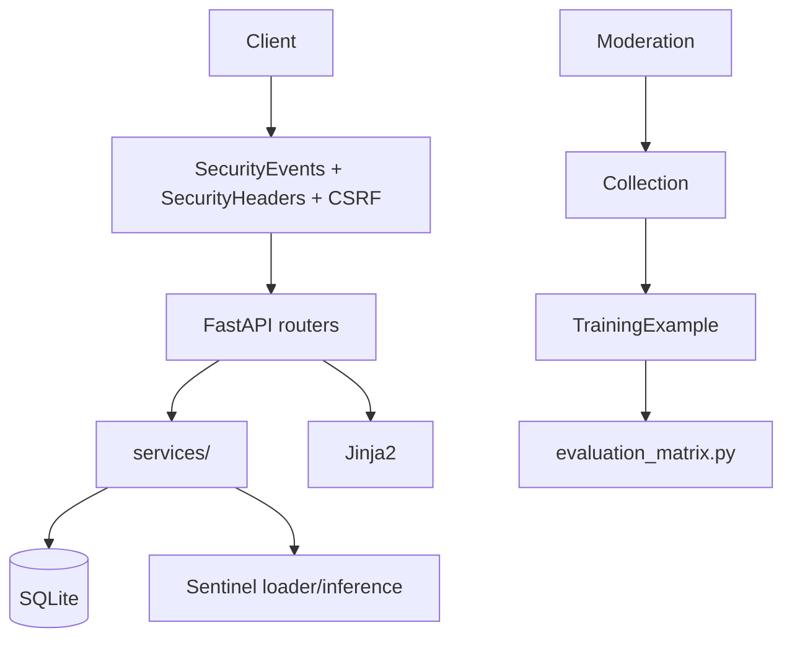

# SentientAI

Local cybersecurity-oriented web application with Sentinel model integration, deterministic security rules, and a human-reviewed moderation pipeline. A public blogging and community site backed by a private administration panel.

Sentinel checkpoints load locally but do not produce reliable structured moderation outputs today (see Current Status and Evaluation). Deterministic rules and model-based analysis are separate components; human review remains the gate.

## 1. Project Overview

**What it is:** FastAPI + Jinja2 + SQLAlchemy community publishing platform with authentication, posts/comments/likes/bookmarks/follows/messages/notifications/search, plus an internal "Sentinel" assistant and the ATTACT assessment toolkit.

**What problem it aims to solve:** Give a realistic, self-hosted content site where security controls, content moderation, and model-assisted triage can be exercised end-to-end without external dependencies.

**Who it is for:** Developers and reviewers who want a runnable local app with real auth, moderation, and evaluation harnesses.

**What currently works:** Public site, auth, admin moderation queue, deterministic brute-force/port-scan rules, Sentinel loader/inference pipeline, ATTACT checks, rate limiting, CSRF, audit log, training review queue.

**What remains experimental:** Reliable structured JSON from Sentinel checkpoints (0% valid JSON today), per-category detection beyond rules, automated training.

## 2. Current Project Status

Honest summary based on existing artifacts (see `Documentation/SENTINEL_DIAGNOSTIC_REPORT.md` and `evaluation/`):

- Checkpoints load: `sentinel_best_model.pt` + `best_autolab_checkpoint.pt` (vocab 7053, max_pos 768, hidden 768, 12 layers) ready via `sentinel_loader.ensure_loaded()` (~1-2s, ~1.9 GB RSS).
- Generation: Model A returns short garbage or repetition (8 tokens), Model B mostly empty due to repetition guard. Neither emits validated JSON.
- Moderation contract `app/services/sentinel_moderation.py` validates `{label,category,confidence,evidence,uncertainty,reasoning_summary}` and never fabricates; `moderation_latest.json` reports `valid_rate 0.0`.
- Deterministic rules: brute-force (8 variants) and port-scan working. Evaluation 26-case: rules precision 0.90 recall 0.56 F1 0.69; models 0% valid JSON; fusion falls back to rules.
- Human review required for all model outputs (`moderation_needs_human_review` returns True on empty/invalid/uncertain).

Do NOT treat Sentinel as a reliable detector; do NOT claim automatic blocking.

## 3. Features

| Feature | Status | Component |
|---|---|---|
| Registration, login, JWT session, password change/reset | Implemented | `app/api/auth.py`, `services/auth_service.py` |
| Posts (draft/published/archived), comments, likes, bookmarks, follows | Implemented | `app/api/blog.py`, `social.py` |
| Messages, notifications, search, contact | Implemented | `app/api/messages.py`, `community.py`, `feed.py` |
| Admin panel, user management, moderation queue, audit log | Implemented | `app/api/admin.py`, `moderation.py` |
| CSRF, Argon2id, security headers, sanitization | Implemented | `services/csrf.py`, `sanitize.py`, middleware |
| Rate limiting (in-process sliding window) | Implemented | `services/ratelimit.py` |
| Sentinel loader/inference | Implemented (low-quality outputs) | `services/sentinel_loader.py`, `sentinel_inference.py` |
| Deterministic rules + fusion | Implemented | `services/sentinel_fusion.py` |
| Moderation JSON contract + human-review gate | Implemented | `services/sentinel_moderation.py` |
| Training review queue (candidate/approved/rejected, 80/20 split, dedup) | Implemented | `services/training.py`, `collection.py` |
| Evaluation harnesses | Implemented | `evaluation_matrix.py`, `evaluation_moderation.py` |
| ATTACT 12 checks (authorized, read-only) | Implemented | `ATTACT/` |
| Incident dedup + TempBlock | Implemented | `services/incident_service.py` |
| Security events + ATTACT persistence | Implemented | `services/security_events.py` |

## 4. Architecture

FastAPI app factory `create_app()` in `app/main.py`. Middleware order: `SecurityEventsMiddleware` (outermost) -> `SecurityHeadersMiddleware` -> `CSRFMiddleware` -> routes. Lifespan calls `init_db()` and schedules Sentinel background warm-load (`init_sentinel(background=True)`, fail-open so missing `torch` never crashes the app).

Routers: health, auth, users, blog, community, social, feed, messages, moderation, admin, sentinel, security_a/b, admin_security. Services: auth, csrf, sanitize, ratelimit, security_events, prompt_service, scoring, training, collection, sentinel_loader/inference/fusion/schema/moderation, incident_service, attact_runner. Models: User, BlogPost, Comment, Social, Message, Moderation, TrainingExample (`sentinel_*` columns), SentinelIncident/TempBlock, SecurityEvent/AttactAssessment, Audit, Activity, Learning. Templates: Jinja2 in `app/templates` with `static/css|js`. DB: SQLAlchemy 2.0 SQLite with model-driven migrations (`_run_migrations` adds missing columns non-destructively).

Sentinel: `SentinelModel` (TransformerEncoder 12 layers, 12 heads, hidden 768, intermediate 3072, vocab 7053, max_pos 768) from `local_models/sentinel/*.pt` + `sentinel_tokenizer.json`. Inference: CPU greedy, semaphore 2, tail-preserving truncation (budget `max_pos-max_new-4`, keep 8 tail incl `</output>`), budget 96 tokens / 12s for moderation, repetition/EOS handling logged.

Flow: request -> rate limit/auth -> moderation report -> `collect_from_moderation` creates CANDIDATE (`safe_to_train=False`) with `sentinel_*` snapshot -> admin reviews -> export approved train split only -> evaluation harnesses isolated from `training_examples`.



## 5. Technology Stack

- Python 3.11, FastAPI 0.115.6, Starlette 0.41, Uvicorn 0.34, SQLAlchemy 2.0, Jinja2 3.1, passlib[argon2] Argon2id, python-jose HS256, python-dotenv, python-multipart, aiofiles
- PyTorch 2.14 CPU, tokenizers 0.23, psutil (RSS) -- optional at runtime, app fails open without them; not in `requirements.txt` so a minimal install still runs the site
- pytest 8.3 + httpx 0.28 for TestClient, SQLite file DB
- No React/SPA; CSP `script-src 'self'`

## 6. Project Directory Structure

```
SentientAI/
  app/main.py, database.py, config.py, template_env.py
  app/api/ (admin, auth, blog, community, social, moderation, sentinel, security_*)
  app/services/ (auth, csrf, sanitize, ratelimit, security_events, prompt_service, scoring, training, collection, sentinel_*)
  app/models/ (user, blog_post, social, moderation, training_example, learning, sentinel_incident, attact_assessment, audit)
  app/templates/ + static/css|js/
  ATTACT/ (checks/, http_client, runner, models, adapters/sentient.py)
  local_models/sentinel/ (config.json, sentinel_tokenizer.json, *.pt - gitignored)
  prompts/prompt.txt, config.py, sentinel_model.py
  evaluation_matrix.py, evaluation_moderation.py, evaluation/latest.json, evaluation/moderation_latest.json
  Documentation/ (SENTINEL_DIAGNOSTIC_REPORT.md, EVALUATION.md, DETECTION_REPORT.md, diagrams, screenshots)
  tests/ (conftest.py + 20+ modules), requirements.txt, requirements-dev.txt, run.py, run.bat, manage.py, pytest.ini
```

## 7. System Requirements

- Python 3.11 (tested; 3.10+ likely)
- pip + venv; ~2 GB RAM for Sentinel warm-load (models ~1.09 GB each, RSS ~1.9 GB). CPU inference works; no GPU required.
- Windows/Linux/macOS; SQLite needs no service. psutil optional for RSS reporting.

## 8. Installation

Portable (after clone):

```bash
git clone https://github.com/UchihaTheGOD/SentientAI.git
cd SentientAI
python -m venv venv
# Windows PowerShell:
.\venv\Scripts\Activate.ps1
# Linux/macOS:
source venv/bin/activate
pip install -r requirements.txt -r requirements-dev.txt
cp .env.example .env   # then edit SECRET_KEY
python manage.py seed-admin
python run.py  # or run.bat start
```

Windows execution-policy note: `Set-ExecutionPolicy -Scope Process -ExecutionPolicy RemoteSigned` for the current PowerShell process if activation is blocked.

If `venv/` already exists, reuse it; no need to recreate.

## 9. Environment Configuration

Copy `.env.example` -> `.env` (never commit `.env`). Verified vars from `app/config.py` and `.env.example`:

| Variable | Default | Purpose |
|---|---|---|
| `SECRET_KEY` | (dev-insecure-key) | HS256 signing; required in production |
| `ENVIRONMENT` | `development` | `development` or `production` |
| `DATABASE_URL` | `sqlite:///./data/sentientai.db` | SQLAlchemy URL |
| `ACCESS_TOKEN_EXPIRE_MINUTES` | `60` | JWT lifetime |
| `PASSWORD_RESET_TOKEN_EXPIRE_MINUTES` | `30` | Reset token TTL |
| `SMTP_HOST`/`PORT`/`USERNAME`/`PASSWORD`/`FROM`/`USE_TLS` | blank | Password-reset email; blank host logs link in dev |

Runs fully locally; no external LLM API required (local Sentinel). `CYBERLLM_*` in `.env` is optional mock.

## 10. Running SentientAI

- `python run.py` -> Uvicorn 127.0.0.1:8000, reload on `app/` (excludes `data/*.db`, `*.log`)
- `run.bat start` / `run.bat test` / `run.bat status` / `run.bat export` / `run.bat export-eval` / `run.bat backfill [--apply]`
- `manage.py`: `seed-admin`, `create-admin`, `set-role`, `list-users`, `seed-blog`, `remove-all-users`, `reset-db --yes` (destructive)
- Docs: http://127.0.0.1:8000/api/docs ; health: `GET /api/health`
- Stop: Ctrl+C

## 11. Sentinel Model Details

Architecture: `SentinelModel` (`nn.TransformerEncoder` 12 layers, 12 heads, hidden 768, intermediate 3072, vocab 7053, max_pos 768, pad 0 unk 1 bos 2 eos 3, specials `<instruction>` 4 .. `</output>` 9, tied embeddings). Config: `local_models/sentinel/config.json`. Tokenizer: `sentinel_tokenizer.json` (byte-fallback, `Ġ`=U+0120).

Loader: `app/services/sentinel_loader.py` ensures dual checkpoints, dedups `best_autolab.pt` vs `best_autolab_checkpoint.pt` by 4 MB prefix hash, tail-preserving truncation, background load.

Inference: `sentinel_inference.py` `_generate_for_model` greedy, timeout 12s, `MAX_NEW 256` (moderation 96), repetition/empty/error handling, latency logged. Protected files: `sentinel_best_model.pt`, `best_autolab_checkpoint.pt`, `best_autolab.pt`, `config.json`, `sentinel_tokenizer.json`, `sentinel_model.py`, `config.py`.

Moderation contract: `sentinel_moderation.py` `MODERATION_INSTRUCTION` DATA ONLY, `validate_moderation_json` requires `label/category/confidence/evidence/uncertainty/reasoning_summary`, `parse_model_text_to_json` never fabricates, `run_moderation_for_text` budget 96/12s, `moderation_needs_human_review` gates.

Limitations: free-form prose fine-tune, no per-category JSON supervision, Model A garbage, Model B empty/repetition, 0% valid JSON. Requires human review. No retrain without approved dataset plan.

## 12. Security Detection and Moderation

Rules vs models are separate. Working deterministic rules: XSS probe contextual (`_is_xss_probe` tag+handler), SQLi probe keyword+operator, traversal `../` + `etc/passwd`/`win.ini`, brute-force `>=5` failed in 10m per IP (window dedup, supports single-line/JSON/syslog/mixed via `_segment_log_text`), port scan `>=8` distinct ports or `nmap`, success-after-fail, rate buckets (7 buckets, sliding window `limit_login 30/300s`), headers/cookie/cors/info-disclosure checks. Evidence capped (`[:2000]` etc), redacted before storage, pseudonymous `ip_hash`.

Model path: `run_moderation_for_text` or `fuse()` / `fuse_structured()`; model vote 0.25 each (0.12 if not ok), rules 0.5; agreement is correlation not confirmation. Empty/invalid/uncertain -> human review; `TrainingExample` never auto-approves (`safe_to_train` only via `apply_review`).

No OS firewall rule is created; `TempBlock` is application-layer only and reversible.

## 13. Training and Data Governance

Lifecycle: candidate (`CANDIDATE`, `safe_to_train False`, from moderation decision only via `collection.collect_from_moderation`) -> human review (`approve`/`reject`/`needs_edit` with reason, `apply_review` sets `safe_to_train`) -> approved `safe_to_train True` -> export train split only (`SPLIT_TRAIN`). Rejected kept with reason (`REJECTION_REASONS`), not deleted. Dedup via `dedup_hash` (SHA256 of normalized instruction+input). Eval split (`SPLIT_EVAL`) isolated; `test_evaluation_set_not_in_training_data` guards against leakage. No auto-promotion. Snapshots limited to 600 chars. Sentinel `sentinel_*` columns stored separately from deterministic `quality_score/band`, never gate approval.

Future retrain prerequisites (gated): properly labeled moderation dataset 80/20 per-category stratified (benign, spam, harassment, prompt_injection, ambiguous, attack sub-categories), benign/suspicious pairs, encoding variants, multiline vs single-line, JSON schema validated, `completion_only` emits after `<output>`, eval isolated, do not overwrite baselines; candidates in `local_models/sentinel/candidates/`.

## 14. Testing

```bash
.\venv\Scripts\python.exe -m pytest tests/ -q
.\venv\Scripts\python.exe -m pytest tests/test_sentinel_moderation_contract.py tests/test_evaluation_matrix.py tests/test_bruteforce_regression.py -v
.\venv\Scripts\python.exe -m pytest tests/test_e2e_review_queue_verification.py -v
```

Covers: auth, blog lifecycle, admin, moderation, csrf, sanitization, scoring, ATTACT scope/checks, prompt path resolution and readiness, sentinel loader/inference/fusion/schema, bruteforce regression, evaluation isolation, moderation contract, E2E review queue. Passing unit tests does not establish detection accuracy.

## 15. Evaluation and Diagnostics

- `evaluation_matrix.py`: 26 fixed log cases (benign 10 inc. 2 suspicious, auth_abuse 8, port_scan 1, xss/sqli/traversal/cmdi/ssrf/ssti/upload 1 each). Each records `ground_truth`, `log_text`, deterministic `rules` verdict/score/latency, `model_a`/`model_b` raw_text/parsed_verdict/status/tokens/latency/stopped/json_valid, `fusion`, agreement. CLI: `python evaluation_matrix.py [--with-models --max-new-tokens 24] --output-dir evaluation`
- `evaluation_moderation.py`: 13-case moderation split (benign 4, spam 3, harassment 2, prompt_injection 2, ambiguous 2) with `attack` bool, sanitized prompt, metrics `valid_rate/tp/fp/tn/fn/precision/recall/f1` to `evaluation/moderation_latest.json`. CLI: `python evaluation_moderation.py --output-dir evaluation`
- `evaluation/latest.json` and `evaluation/moderation_latest.json`: baselines (rules F1 0.69, models 0% JSON). Historical `results_*.json` removed as duplicate clutter; only latest baselines retained.
- `Documentation/SENTINEL_DIAGNOSTIC_REPORT.md`: loader/prompt/generation root cause.
- `Documentation/EVALUATION.md` and `DETECTION_REPORT.md`: honest results and coverage table.

Valid JSON vs correct security classification are distinct; empty is not a prediction. Small-n categories (`n=1`) flagged insufficient.

## 16. Database and Administration

SQLite file `data/sentientai.db` (gitignored via `data/*.db` and `*.db`; `.gitkeep` preserves the directory). `init_db()` creates tables, then `_run_migrations` adds any missing columns non-destructively and backfills legacy rows. Admin access: every `/admin` route depends on `require_admin`. Management: `python manage.py seed-admin` (creates `admin`/`admin@12345` -- change password after first login), `list-users`, `set-role`, `remove-all-users`, `reset-db --yes` (destructive: drop + recreate + seed one admin). Review queue: `/admin/training` pending/rejected, approve/reject/needs_edit, export train JSONL via `/admin/export` or `run.bat export` (eval via `export-eval`).

Do not expose admin credentials in logs or docs. Default bootstrap credentials are for local development only.

## 17. Troubleshooting

- Missing deps: `pip install -r requirements.txt -r requirements-dev.txt` in activated venv; verify with `.\venv\Scripts\python.exe -c "import app.main; app.main.create_app(); print('ok')"`
- venv activation: PowerShell `Set-ExecutionPolicy -Scope Process -ExecutionPolicy RemoteSigned` for current process
- Startup errors: check `.env` (`SECRET_KEY` required when `ENVIRONMENT=production`), `DATABASE_URL`, `python run.py` logs; `init_db()` is idempotent
- DB `no such column`: `init_db` migration should auto-add; if old DB still fails: restart app or `python manage.py reset-db --yes` (destructive, loses data)
- Model not ready: `GET /api/sentinel/readiness`; `POST /api/sentinel/readiness/load` as admin; check `local_models/sentinel/` files exist, `torch`/`tokenizers` installed, RAM (~2 GB). App fails open without them.
- Empty/repetition JSON: expected baseline -- human review required; see `SENTINEL_DIAGNOSTIC_REPORT.md`, `evaluation/moderation_latest.json`
- Invalid JSON moderation: `parse_model_text_to_json` rejects malformed; check `raw_text` in `admin_training` badge or `evaluation/moderation_latest.json`
- Test failures: ensure clean venv, no running server needed (`tests/conftest.py` uses throwaway SQLite file), `ratelimit.reset()` per test; `pytest.ini` (`testpaths = tests`)

## 18. Security and Responsible Use

Experimental. Not a guaranteed defense. Human review and independent validation required. Sentinel assessments are provisional (`likely_benign`/`needs_review`/`likely_threat`) and require a reviewer. Do not test systems without authorization. ATTACT requires `--confirm-authorized` and allowlist for non-loopback. No secrets in logs/docs. Reports are monitor-only; application-level `TempBlock` does not create OS firewall rules.

## 19. Limitations and Roadmap

Current limitations: 0% valid JSON from checkpoints, no per-category precision/recall beyond auth_abuse/port_scan, narrow rules, small-n categories (n=1 each for xss/sqli/traversal/cmdi/ssrf/ssti/upload), in-process rate limit (single process only), prompt injection handled as DATA ONLY only in moderation path, no GPU.

Roadmap (future work): properly labeled moderation dataset 80/20 stratified per category with benign/suspicious pairs and encoding variants, JSON-validated `completion_only` after `<output>`, eval isolated, per-category precision/recall + ECE, injection robustness, preserve baselines, improve structured generation reliability.

## 20. Contributing and Development

- Use venv, run `pytest` before committing, keep `.env` and `local_models/*.pt` out of git (see `.gitignore`).
- Branch `main` tracks `origin/main`; do not force-push or rewrite history.
- Follow existing conventions; add tests for new behavior; document limits honestly.

No license file is present; add one deliberately if you intend to license.

## 21. License

No LICENSE file was found in this repository at the time of this cleanup. Reuse and redistribution permissions should not be assumed.

## 22. Project Disclaimer

Evolving project. Experimental detections require independent validation. Model outputs are provisional and require human review. Do not rely on this app as a sole security control.

## 23. Documentation Links

- `Documentation/SENTINEL_DIAGNOSTIC_REPORT.md` -- reproducible failure analysis
- `Documentation/EVALUATION.md` -- 26-case + with-models baseline
- `Documentation/DETECTION_REPORT.md` -- evidence-based coverage
- `Documentation/SENTIENTAI_AUDIT.md` -- broader project audit
- `ATTACT/README.md` -- Authorized assessment toolkit
- `DOCUMENTATION.md`, `IMPLEMENTATION_REPORT.md`, `VERIFICATION_REPORT.md`, `CHECKPOINT_DB_SCHEMA_FIX.md`
- `app/main.py`, `app/services/sentinel_moderation.py`, `app/services/sentinel_loader.py`, `sentinel_model.py`, `config.py`, `evaluation_matrix.py`, `evaluation_moderation.py`
