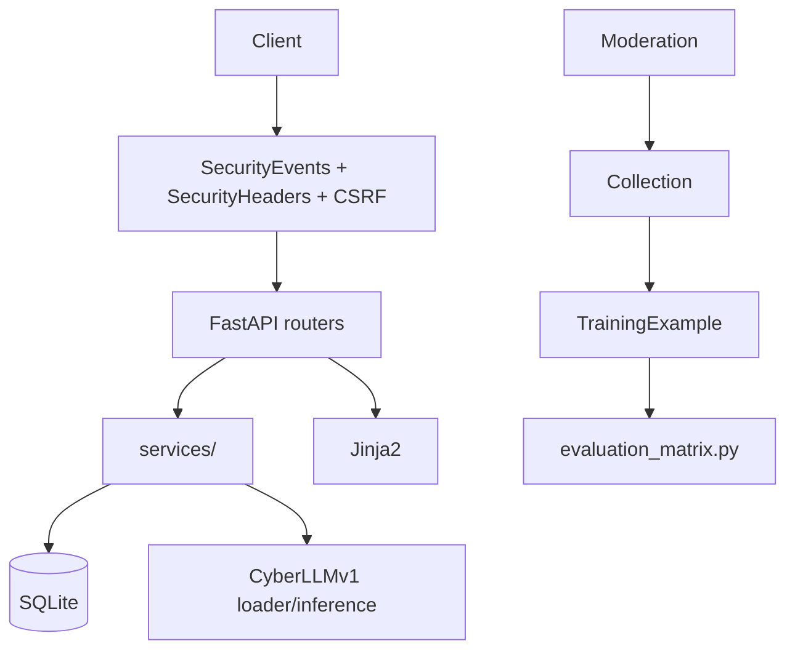

# SentientAI

Local cybersecurity-oriented web application with CyberLLMv1 model integration, deterministic security rules, and a human-reviewed moderation pipeline. A public blogging and community site backed by a private administration panel, plus a native desktop Security Lab.

Current version: `1.0.0-rc.1` (release candidate — see `VERSION`, `CHANGELOG.md`). The obsolete Sentinel model pipeline was removed on 2026-10-27 and replaced by CyberLLMv1 (see §2, §11). Deterministic rules and model-based analysis are separate components; human review remains the gate.

Verified on Linux (this branch, 2026-10-28): website suite 635 passed + 1 skipped, Security Lab suite 47 passed + 1 skipped. NOT yet verified: Windows test run, Windows exe build/double-click, GPU fit/latency, real 1.7B inference on the reference PC. Linux results are not proof of Windows compatibility.

## 1. Project Overview

**What it is:** FastAPI + Jinja2 + SQLAlchemy community publishing platform with authentication, posts/comments/likes/bookmarks/follows/messages/notifications/search, plus an internal "Sentinel" assistant and the ATTACT assessment toolkit.

**What problem it aims to solve:** Give a realistic, self-hosted content site where security controls, content moderation, and model-assisted triage can be exercised end-to-end without external dependencies.

**Who it is for:** Developers and reviewers who want a runnable local app with real auth, moderation, and evaluation harnesses.

**What currently works:** Public site, auth, admin moderation queue, deterministic brute-force/port-scan rules, CyberLLMv1 classification + rules fusion, ATTACT checks, rate limiting, CSRF, audit log, training review queue, native desktop Security Lab GUI (Control Center, authorized scanner, model testing, user management, reports, cases, demo, diagnostics, settings), admin users API with backend-enforced guards, portable Windows runtime (`run.bat`/`run.sh`, `.venv` or `venv`). (The obsolete Sentinel Model A/B pipeline was removed on 2026-10-27; see §11.)

**What remains experimental:** Per-category detection beyond rules, automated training. CyberLLMv1 classification is validated JSON with evidence checks, but it is not a deployable detector on its own — human review is still required for consequential decisions.

## 2. Current Project Status

Honest summary (see `reports/migration_obsolete_models_removed.md` for the 2026-10-27 migration):

- Classification: CyberLLMv1 (Qwen3-1.7B + LoRA v8, data-v3.2) via `app/services/classifier.py`, fused with deterministic rules (50% rules / 50% confident model; rules-only when the model is unavailable, unparseable, or evidence-inconsistent). No dual-model inference, no model agreement, no Sentinel checkpoints.
- Deterministic rules: brute-force (8 variants) and port-scan working. Evaluation 26-case: rules precision 0.90 recall 0.56 F1 0.69 (historical, rules unchanged by the migration).
- Moderation: human-only. The old Sentinel moderation model was removed; CyberLLMv1 is not a content-moderation model.
- Human review required for all consequential decisions.
- Branch and version: `feature/cyberllm-desktop-portable`, version `1.0.0-rc.1` (`VERSION`, `CHANGELOG.md`, tag `v1.0.0-rc.1`). Stable `v1.0.0` requires the Windows battery: exe build + double-click, GPU fit/latency, real 1.7B inference, Windows test run.
- Desktop app: native PySide6 Security Lab (`security_lab/`, 9 pages); the exe bundles the GUI only — backend deps, torch, and model files stay on the machine (see `security_lab/packaging/BUILD_GUIDE.md`).
- Rollback: check out tag `v1.0.0-rc.1` (procedure in `CHANGELOG.md`).

Do NOT treat any single model output as a reliable detector; do NOT claim automatic blocking.

## 3. Features

| Feature | Status | Component |
|---|---|---|
| Registration, login, JWT session, password change/reset | Implemented | `app/api/auth.py`, `services/auth_service.py` |
| Posts (draft/published/archived), comments, likes, bookmarks, follows | Implemented | `app/api/blog.py`, `social.py` |
| Messages, notifications, search, contact | Implemented | `app/api/messages.py`, `community.py`, `feed.py` |
| Admin panel, user management, moderation queue, audit log | Implemented | `app/api/admin.py`, `moderation.py` |
| CSRF, Argon2id, security headers, sanitization | Implemented | `services/csrf.py`, `sanitize.py`, middleware |
| Rate limiting (in-process sliding window) | Implemented | `services/ratelimit.py` |
| CyberLLMv1 classification | Implemented | `services/classifier.py`, `cyberllm_loader.py`, `cyberllm_inference.py` |
| Deterministic rules + fusion | Implemented | `services/security_rules.py`, `services/classifier.py` |
| Moderation (human-only) + human-review gate | Implemented | `api/moderation.py`, `services/collection.py` |
| Training review queue (candidate/approved/rejected, 80/20 split, dedup) | Implemented | `services/training.py`, `collection.py` |
| Evaluation harnesses | Implemented | `evaluation_matrix.py`, `evaluation_moderation.py` |
| ATTACT 12 checks (authorized, read-only) | Implemented | `ATTACT/` |
| Incident dedup + TempBlock | Implemented | `services/incident_service.py` |
| Security events + ATTACT persistence | Implemented | `services/security_events.py` |
| Desktop Security Lab GUI (9 pages) | Implemented (source runs; exe unbuilt on Windows) | `security_lab/` |
| Admin users API (role/active/suspend/create/reset/audit) | Implemented | `app/api/admin_users.py` |
| Portable runtime (`run.bat`/`run.sh`, `.venv` or `venv`) | Implemented | `run.bat`, `run.sh` |

## 4. Architecture

FastAPI app factory `create_app()` in `app/main.py`. Middleware order: `SecurityEventsMiddleware` (outermost) -> `SecurityHeadersMiddleware` -> `CSRFMiddleware` -> routes. Lifespan calls `init_db()` only; no model loads at startup. CyberLLMv1 loads lazily on explicit load/analyze, so a missing model never blocks the app.

Routers: health, auth, users, blog, community, social, feed, messages, moderation, admin, admin_users, sentinel, cyberllm, security, lab, admin_security, theme, reports alias. Services: auth, csrf, sanitize, ratelimit, security_events, log_validation, classifier, security_rules, cyberllm_loader/inference/schema/evidence/rules, scoring, training, collection, incident_service, attact_runner. Desktop GUI: `security_lab/` (PySide6; starts the same backend as a subprocess, does not embed the web UI). Models: User, BlogPost, Comment, Social, Message, Moderation, TrainingExample (legacy-named `sentinel_*` storage columns, now recording the human-only moderation status), SentinelIncident/TempBlock (incident records; the name is historical, not a model), SecurityEvent/AttactAssessment, Audit, Activity, Learning. Templates: Jinja2 in `app/templates` with `static/css|js`. DB: SQLAlchemy 2.0 SQLite with model-driven migrations (`_run_migrations` adds missing columns non-destructively).

CyberLLMv1: Qwen3-1.7B @ `70d244cc…` + LoRA v8 adapter (SHA-256 `d624ed79…5a5b1`) in `cyberLLMv1/{base,adapter}`, loaded lazily, float16 on CUDA, adapter SHA verified on load. Classification is JSON-validated with evidence checks; mismatches, truncation, and unjustified high-confidence threats downgrade to `needs_review`.

Flow: request -> rate limit/auth -> moderation report -> `collect_from_moderation` creates CANDIDATE (`safe_to_train=False`) from the moderator's decision (model annotation: `model_removed_human_review_only`) -> admin reviews -> export approved train split only -> evaluation harnesses isolated from `training_examples`.



## 5. Technology Stack

- Python 3.11 or 3.12, FastAPI 0.115.6, Starlette 0.41, Uvicorn 0.34, SQLAlchemy 2.0, Jinja2 3.1, passlib[argon2] Argon2id, python-jose HS256, python-dotenv, python-multipart, aiofiles
- torch (CUDA 12.1 wheel, separate install), transformers 5.16.1, peft 0.20.0, accelerate 1.14.0, psutil (RSS) -- optional at runtime, app fails open without them; not in `requirements.txt` so a minimal install still runs the site (see `CYBERLLM_PORTABLE_SETUP.md`)
- pytest 8.3.4 + httpx 0.28.1 for TestClient, SQLite file DB
- No React/SPA; CSP `script-src 'self'`

## 6. Project Directory Structure

```
SentientAI/
  app/main.py, database.py, config.py, template_env.py
  app/api/ (admin, admin_users, auth, blog, community, social, moderation, sentinel, cyberllm, security_*, lab, theme)
  app/services/ (auth, csrf, sanitize, ratelimit, security_events, log_validation, classifier, security_rules, cyberllm_*, scoring, training, collection)
  app/models/ (user, blog_post, social, moderation, training_example, learning, sentinel_incident, attact_assessment, audit)
  app/templates/ + static/css|js/
  security_lab/ (PySide6 desktop app: gui/, scanner/, packaging/; tests/)
  ATTACT/ (checks/, http_client, runner, models, adapters/sentient.py)
  cyberLLMv1/ (base/, adapter/, manifest.json, README.md — weights gitignored)
  scripts/setup_cyberllm.py (model download + SHA check)
  evaluation_matrix.py, evaluation_moderation.py, evaluation/latest.json, evaluation/moderation_latest.json
  Documentation/ (SENTINEL_DIAGNOSTIC_REPORT.md, EVALUATION.md, DETECTION_REPORT.md, diagrams, screenshots)
  tests/ (44 Python files incl. conftest.py), security_lab/tests/ (11 test modules), requirements.txt, requirements-dev.txt, run.py, run.bat, run.sh, manage.py, pytest.ini
  VERSION, CHANGELOG.md, DEVELOPMENT_LOG.md, CYBERLLM_PORTABLE_SETUP.md, CYBERLLM_WINDOWS_SETUP.md, WINDOWS_TEST_CHECKLIST.md
```

## 7. System Requirements

- Python 3.11 or 3.12 (3.12 used on the reference Windows PC)
- pip + venv (`.venv` or `venv`; `run.bat`/`run.sh` try `.venv` first)
- CyberLLMv1 1.7B: base ~4.1 GB + adapter ~82 MB on disk; CPU load measured 4.53 GB peak RSS in a 2-CPU VM (2026-10-24); GPU peak VRAM ~4.5 GB is an unverified estimate. The site runs rules-only without the model; no GPU required.
- Windows/Linux/macOS; SQLite needs no service. psutil optional for RSS reporting.

## 8. Installation

Portable (after clone):

```bash
git clone https://github.com/UchihaTheGOD/SentientAI.git
cd SentientAI
python -m venv venv
# Windows PowerShell:
.\venv\Scripts\Activate.ps1
# Linux/macOS:
source venv/bin/activate
pip install -r requirements.txt -r requirements-dev.txt
# Model runtime (not in requirements.txt; CUDA 12.1 wheel supports Turing):
.\venv\Scripts\python.exe -m pip install torch --index-url https://download.pytorch.org/whl/cu121
cp .env.example .env   # then edit SECRET_KEY
python scripts\setup_cyberllm.py --check   # then --download-base / --download-adapter
python manage.py seed-admin
python run.py  # or run.bat start
# Desktop GUI (from source): python -m security_lab (GUI deps first, see security_lab/README.md)
# Windows exe: security_lab\packaging\build_windows.bat (GUI only; backend + model stay on the machine)
```

Windows execution-policy note: `Set-ExecutionPolicy -Scope Process -ExecutionPolicy RemoteSigned` for the current PowerShell process if activation is blocked.

If `venv/` already exists, reuse it; no need to recreate.

## 9. Environment Configuration

Copy `.env.example` -> `.env` (never commit `.env`). Verified vars from `app/config.py` and `.env.example`:

| Variable | Default | Purpose |
|---|---|---|
| `SECRET_KEY` | (dev-insecure-key) | HS256 signing; required in production |
| `ENVIRONMENT` | `development` | `development` or `production` |
| `DATABASE_URL` | (see `.env.example`) | SQLAlchemy URL; local SQLite file |
| `ACCESS_TOKEN_EXPIRE_MINUTES` | `60` | JWT lifetime |
| `PASSWORD_RESET_TOKEN_EXPIRE_MINUTES` | `30` | Reset token TTL |
| `SMTP_HOST`/`PORT`/`USERNAME`/`PASSWORD`/`FROM`/`USE_TLS` | blank | Password-reset email; blank host logs link in dev |
| `CYBERLLM_MODEL_ROOT` | (unset) | Model root; `{root}/base` + `{root}/adapter` used when set |
| `CYBERLLM_BASE_DIR` / `CYBERLLM_ADAPTER_DIR` | (unset) | Explicit base / adapter dirs; override `MODEL_ROOT` |
| `CYBERLLM_BASE_MODEL` | `Qwen/Qwen3-1.7B` | Base model id |
| `CYBERLLM_BASE_REVISION` | `70d244cc…` | Pinned base revision |
| `CYBERLLM_ADAPTER_SHA256` | `d624ed79…5a5b1` | Expected adapter SHA-256; load refuses on mismatch |
| `CYBERLLM_DEVICE` | `auto` | `auto` / `cpu` / `cuda` |
| `CYBERLLM_LOAD_IN_8BIT` | (unset) | Set `1` for 8-bit load (Turing fallback) |

Runs fully locally; no external LLM API required (local CyberLLMv1). Model paths come from `CYBERLLM_*` (see the table above and `.env.example`).

## 10. Running SentientAI

- `python run.py` -> Uvicorn 127.0.0.1:8000, reload on `app/` (excludes `data/*.db`, `*.log`)
- `run.bat start` / `run.bat test` / `run.bat status` / `run.bat export` / `run.bat export-eval` / `run.bat backfill [--apply]`
- `run.sh start` / `run.sh test` / `run.sh status` (Linux/macOS counterpart of `run.bat`)
- Desktop GUI from source: `python -m security_lab` from the project root (GUI deps: `pip install -r security_lab/packaging/requirements-gui.txt`); Control Center starts/stops the same backend
- Windows exe: `security_lab\packaging\build_windows.bat` -> `dist\CyberLLMv1-Security-Lab.exe` (one-file, unsigned; bundles the GUI only — backend deps, torch, and model files must already be on the machine)
- `manage.py`: `seed-admin`, `create-admin`, `set-role`, `list-users`, `seed-blog`, `remove-all-users`, `reset-db --yes` (destructive)
- Docs: http://127.0.0.1:8000/api/docs ; health: `GET /api/health`
- Stop: Ctrl+C

## 11. CyberLLMv1 Model Details (Sentinel models removed 2026-10-27)

The old Sentinel models (`SentinelModel`, `sentinel_best_model.pt`, `best_autolab_checkpoint.pt`, `sentinel_tokenizer.json`, `prompts/prompt.txt`, `sentinel_loader.py`, `sentinel_inference.py`, `sentinel_fusion.py`, `sentinel_schema.py`, `sentinel_moderation.py`, `prompt_service.py`) were removed. Do not download the old checkpoints; nothing requires them.

CyberLLMv1: base `Qwen/Qwen3-1.7B` @ revision `70d244cc86ccca08cf5af4e1e306ecf908b1ad5e`, LoRA adapter pilot v8 data-v3.2, SHA-256 `d624ed793a45a64cb541577441c87c7d2feb83c37a84da057d1c15e58e45a5b1`, in `cyberLLMv1/{base,adapter}` (project-local, `CYBERLLM_MODEL_ROOT` / `CYBERLLM_BASE_DIR` / `CYBERLLM_ADAPTER_DIR` overrides). Loader: `app/services/cyberllm_loader.py` (project-root-relative, explicit incomplete roots fail clearly, adapter SHA verified). Inference: `app/services/cyberllm_inference.py` (trained templates verbatim, `enable_thinking=False`, budgets 320/512 tokens). Adapter: `app/services/classifier.py` (`classify_log` + `fuse_classification`) is the interface used by Sentinel-style analyze, bridge, demo, and lab workflows.

Limitations: CyberLLMv1 is a research candidate, not a deployable detector on its own; it has no MITRE field by design (exact technique-ID prediction measured 0.000–0.025 across pilots); it is not a content-moderation model. Human review is required for consequential decisions. No retraining in this release.

## 12. Security Detection and Moderation

Rules vs models are separate. Working deterministic rules: XSS probe contextual (`_is_xss_probe` tag+handler), SQLi probe keyword+operator, traversal `../` + `etc/passwd`/`win.ini`, brute-force `>=5` failed in 10m per IP (window dedup, supports single-line/JSON/syslog/mixed via `_segment_log_text`), port scan `>=8` distinct ports or `nmap`, success-after-fail, rate buckets (7 buckets, sliding window `limit_login 30/300s`), headers/cookie/cors/info-disclosure checks. Evidence capped (`[:2000]` etc), redacted before storage, pseudonymous `ip_hash`.

Model path: CyberLLMv1 classification via `classifier.classify_log`, fused by `fuse_classification` (rules 50% + confident model 50%; SSRF/metadata deterministic override; unavailable/unparseable/mismatched/truncated -> `needs_review`). Empty/invalid/uncertain -> human review; `TrainingExample` never auto-approves (`safe_to_train` only via `apply_review`).

No OS firewall rule is created; `TempBlock` is application-layer only and reversible.
## 13. Training and Data Governance

Lifecycle: candidate (`CANDIDATE`, `safe_to_train False`, from moderation decision only via `collection.collect_from_moderation`) -> human review (`approve`/`reject`/`needs_edit` with reason, `apply_review` sets `safe_to_train`) -> approved `safe_to_train True` -> export train split only (`SPLIT_TRAIN`). Rejected kept with reason (`REJECTION_REASONS`), not deleted. Dedup via `dedup_hash` (SHA256 of normalized instruction+input). Eval split (`SPLIT_EVAL`) isolated; `test_evaluation_set_not_in_training_data` guards against leakage. No auto-promotion. Snapshots limited to 600 chars. Sentinel `sentinel_*` columns stored separately from deterministic `quality_score/band`, never gate approval.

Future retrain prerequisites (gated): properly labeled moderation dataset 80/20 per-category stratified (benign, spam, harassment, prompt_injection, ambiguous, attack sub-categories), benign/suspicious pairs, encoding variants, multiline vs single-line, JSON schema validated, `completion_only` emits after `<output>`, eval isolated, do not overwrite baselines; candidates are exported as JSONL via the review queue (§16); no model weights are stored in the repo.

## 14. Testing

```bash
.\venv\Scripts\python.exe -m pytest tests/ -q
.\venv\Scripts\python.exe -m pytest security_lab/tests/ -q
.\venv\Scripts\python.exe -m pytest tests/test_sentinel_moderation_contract.py tests/test_evaluation_matrix.py tests/test_bruteforce_regression.py -v
.\venv\Scripts\python.exe -m pytest tests/test_e2e_review_queue_verification.py -v
```

Baseline on this branch (2026-10-28, Linux): website 635 passed + 1 skipped (pre-existing template skip); Security Lab 47 passed + 1 skipped (real-model smoke, needs weights + `CYBERLLM_REAL_MODEL=1`).

Covers: auth, blog lifecycle, admin, moderation, csrf, sanitization, scoring, ATTACT scope/checks, classifier adapter and fusion, log validation, bruteforce regression, evaluation isolation, moderation contract, E2E review queue, Security Lab GUI smoke, scanner safety, client/admin API, model/evaluation, reports redaction. Passing unit tests does not establish detection accuracy.

## 15. Evaluation and Diagnostics

- `evaluation_matrix.py`: 26 fixed log cases (benign 10 inc. 2 suspicious, auth_abuse 8, port_scan 1, xss/sqli/traversal/cmdi/ssrf/ssti/upload 1 each). Each records `ground_truth`, `log_text`, deterministic `rules` verdict/score/latency, single CyberLLMv1 `classification`, `fusion`. CLI: `python evaluation_matrix.py [--with-models --max-new-tokens 24] --output-dir evaluation`
- `evaluation_moderation.py`: 13-case moderation split (benign 4, spam 3, harassment 2, prompt_injection 2, ambiguous 2) with `attack` bool, metrics `valid_rate/tp/fp/tn/fn/precision/recall/f1` to `evaluation/moderation_latest.json`. No model is run (moderation is human-only since the 2026-10-27 migration); `valid_rate` is honestly 0.0. CLI: `python evaluation_moderation.py --output-dir evaluation`
- `evaluation/latest.json` and `evaluation/moderation_latest.json`: the committed baselines are Sentinel-era (pre-migration, 26-case rules F1 0.69, Sentinel models 0% valid JSON) and are kept as history. For current test status see §14 and `reports/TEST_RESULTS.md`. The working-tree evaluation files are uncommitted churn — never commit them. Historical `results_*.json` removed as duplicate clutter; only latest baselines retained.
- `Documentation/SENTINEL_DIAGNOSTIC_REPORT.md`: loader/prompt/generation root cause.
- `Documentation/EVALUATION.md` and `DETECTION_REPORT.md`: honest results and coverage table.

Valid JSON vs correct security classification are distinct; empty is not a prediction. Small-n categories (`n=1`) flagged insufficient.

## 16. Database and Administration

SQLite file database (gitignored via `*.db`; path from `DATABASE_URL`). `init_db()` creates tables, then `_run_migrations` adds any missing columns non-destructively and backfills legacy rows. Admin access: every `/admin` route depends on `require_admin`. Management: `python manage.py seed-admin` (creates a bootstrap admin — change its password immediately after first login), `list-users`, `set-role`, `remove-all-users`, `reset-db --yes` (destructive: drop + recreate + seed one admin). Review queue: `/admin/training` pending/rejected, approve/reject/needs_edit, export train JSONL via `/admin/export` or `run.bat export` (eval via `export-eval`).

Do not expose admin credentials in logs or docs. Default bootstrap credentials are for local development only.

## 17. Troubleshooting

- Missing deps: `pip install -r requirements.txt -r requirements-dev.txt` in activated venv; verify with `.\venv\Scripts\python.exe -c "import app.main; app.main.create_app(); print('ok')"`
- venv activation: PowerShell `Set-ExecutionPolicy -Scope Process -ExecutionPolicy RemoteSigned` for current process
- Startup errors: check `.env` (`SECRET_KEY` required when `ENVIRONMENT=production`), `DATABASE_URL`, `python run.py` logs; `init_db()` is idempotent
- DB `no such column`: `init_db` migration should auto-add; if old DB still fails: restart app or `python manage.py reset-db --yes` (destructive, loses data)
- Model not ready: `GET /api/sentinel/readiness` (or `GET /api/cyberllm/readiness`); `POST /api/sentinel/readiness/load` as admin; check `cyberLLMv1/base/` and `cyberLLMv1/adapter/` exist and the adapter SHA matches, `torch`/`transformers`/`peft` installed. The app starts and works rules-only without the model; the CyberLLM endpoint returns 503 `model_unavailable` honestly.
- Unparseable model output: downgraded to `needs_review` — human review required; inspect the raw output pane (GUI Model Testing) and `decision_source` (`unparseable_output`)
- Invalid model JSON: `cyberllm_schema.parse_model_output` rejects malformed output; the adapter returns `needs_review` with the raw text preserved for a human.
- Test failures: ensure clean venv, no running server needed (`tests/conftest.py` uses throwaway SQLite file), `ratelimit.reset()` per test; `pytest.ini` (`testpaths = tests`)

## 18. Security and Responsible Use

Experimental. Not a guaranteed defense. Human review and independent validation required. CyberLLMv1 assessments are provisional (`likely_benign`/`needs_review`/`likely_threat`) and require a reviewer. Do not test systems without authorization. ATTACT requires `--confirm-authorized` and allowlist for non-loopback. No secrets in logs/docs. Reports are monitor-only; application-level `TempBlock` does not create OS firewall rules.

## 19. Limitations and Roadmap

Current limitations: CyberLLMv1 exact MITRE technique-ID prediction measured 0.000–0.025 across pilots (no MITRE field by design); no per-category precision/recall beyond auth_abuse/port_scan; narrow rules; small-n categories (n=1 each for xss/sqli/traversal/cmdi/ssrf/ssti/upload); in-process rate limit (single process only); prompt injection handled as DATA ONLY only in moderation path; Windows exe build, GPU fit/latency, and real 1.7B inference unverified (Linux CPU results only).

Roadmap (future work): Windows battery (exe build + double-click, GPU fit/latency, real 1.7B inference, Windows test run) to promote `1.0.0-rc.1` to stable `v1.0.0`; properly labeled moderation dataset 80/20 stratified per category with benign/suspicious pairs and encoding variants; eval isolated; per-category precision/recall + ECE; injection robustness; preserve baselines; improve structured generation reliability.

## 20. Contributing and Development

- Use venv, run `pytest` before committing, keep `.env` and model weights out of git (see `.gitignore`).
- Work on `feature/cyberllm-desktop-portable`; do not force-push, rewrite history, or push to other branches.
- Follow existing conventions; add tests for new behavior; document limits honestly.

No license file is present; add one deliberately if you intend to license.

## 21. License

No LICENSE file was found in this repository at the time of this cleanup. Reuse and redistribution permissions should not be assumed.

## 22. Project Disclaimer

Evolving project. Experimental detections require independent validation. Model outputs are provisional and require human review. Do not rely on this app as a sole security control.

## 23. Documentation Links

- `CHANGELOG.md`, `VERSION`, `DEVELOPMENT_LOG.md` -- version history, release notes, development record
- `CYBERLLM_PORTABLE_SETUP.md`, `CYBERLLM_WINDOWS_SETUP.md`, `WINDOWS_TEST_CHECKLIST.md` -- setup + Windows verification
- `security_lab/packaging/BUILD_GUIDE.md`, `security_lab/README.md` -- desktop app build + user guide
- `reports/TEST_RESULTS.md`, `reports/RELEASE_READINESS.md`, `reports/PORTABILITY_REPORT.md` -- branch test + release evidence
- `Documentation/SENTINEL_DIAGNOSTIC_REPORT.md` -- reproducible failure analysis (historical, Sentinel-era)
- `Documentation/EVALUATION.md` -- 26-case + with-models baseline
- `Documentation/DETECTION_REPORT.md` -- evidence-based coverage
- `Documentation/SENTIENTAI_AUDIT.md` -- broader project audit
- `ATTACT/README.md` -- Authorized assessment toolkit
- `DOCUMENTATION.md`, `IMPLEMENTATION_REPORT.md`, `VERIFICATION_REPORT.md`, `CHECKPOINT_DB_SCHEMA_FIX.md`
- `app/main.py`, `app/services/classifier.py`, `app/services/cyberllm_loader.py`, `evaluation_matrix.py`, `evaluation_moderation.py`
